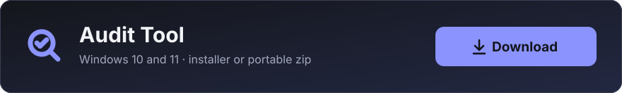
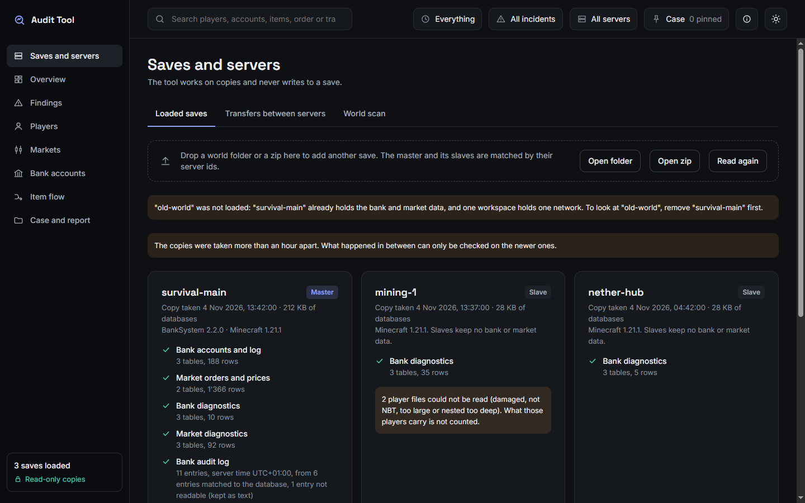
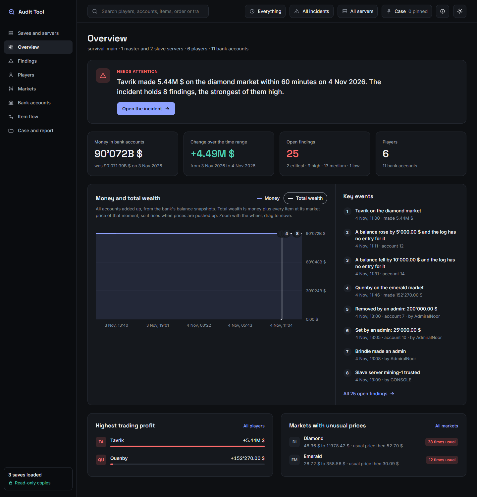
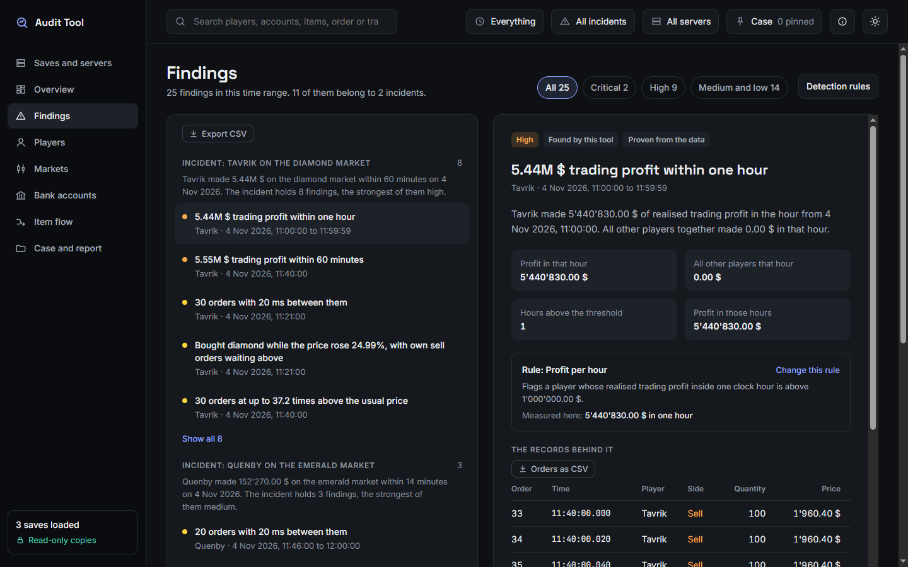
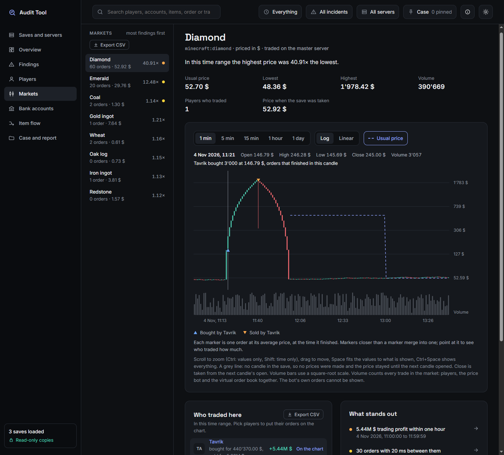
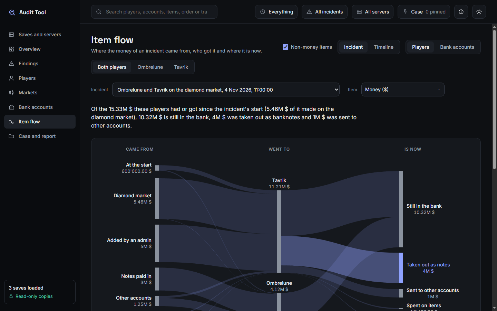
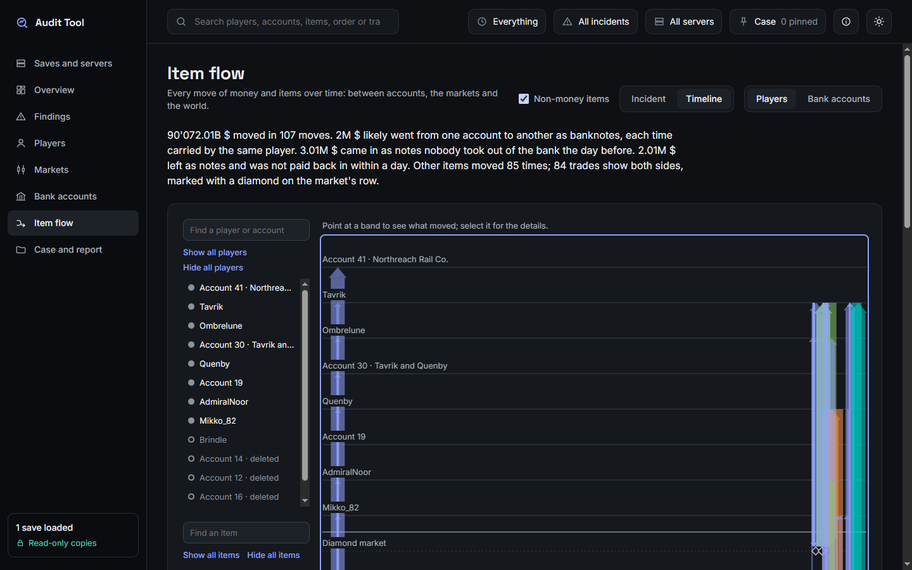
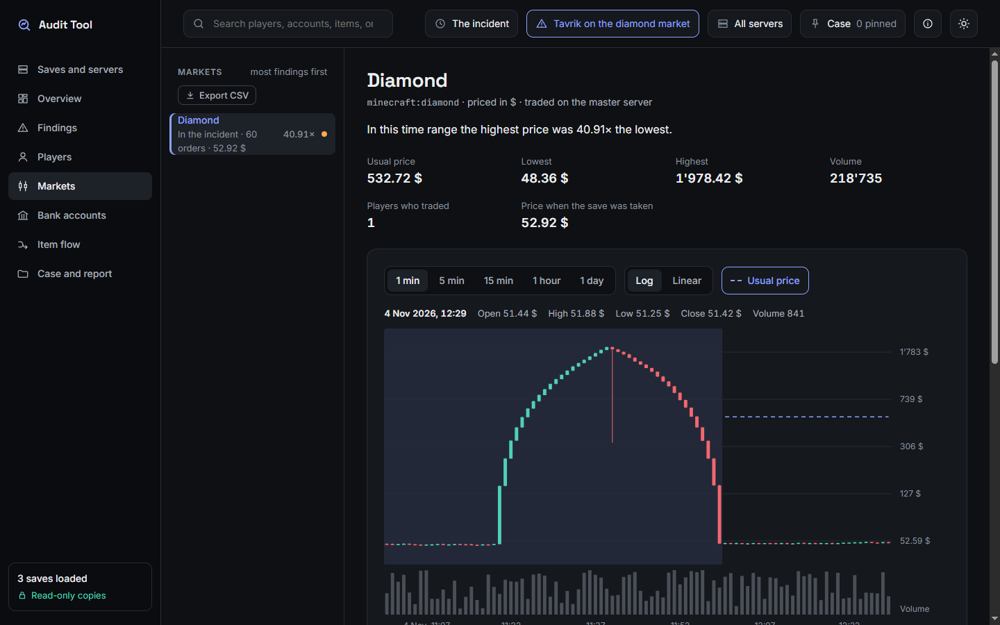
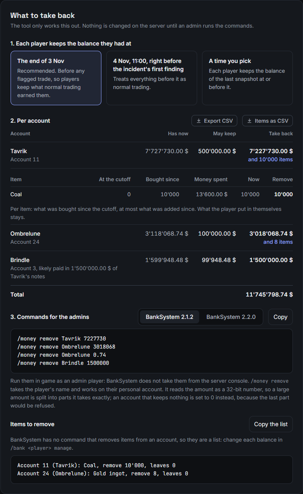

# Audit Tool

An offline investigation tool for Minecraft server networks that run the [BankSystem](https://github.com/KROIA/BankSystem)
and [StockMarket](https://github.com/KROIA/StockMarket) mods. It loads
copies of the saves of a master and its slaves, finds signs of exploits and cheating, follows the money and writes a
report for the admins: who gained what, how, and what to take back.

It only reads. It works on copies, never writes into a save and never connects to a server.

[](https://github.com/KROIA/BS_SM_AuditTool/releases/latest)

## Install

Windows 10 or 11, 64-bit. Nothing else is needed. Both files are on the
[Releases](https://github.com/KROIA/BS_SM_AuditTool/releases) page.

- **Installer**: `Audit Tool Setup <version>.exe` installs for the current user, without admin rights, and adds a Start
  menu entry and a desktop shortcut. You choose the folder; the default is `%LOCALAPPDATA%\Programs\Audit Tool`. The
  program always gets a folder of its own named `Audit Tool`: if you pick `D:\Tools`, it goes to `D:\Tools\Audit Tool`,
  because uninstalling deletes that folder with everything in it. A silent install takes `/S /D=<folder>` the same way.
  Uninstall it like any program. Your workspace in `%APPDATA%\audit-tool` stays, so delete that folder too if you want
  everything gone.
- **Without installing**: unpack `Audit Tool-<version>-win.zip` anywhere and start `Audit Tool.exe`.

The files are not code-signed, so Windows SmartScreen may warn on the first start ("More info", then "Run anyway").

## From a server to a report

1. **Get the saves.** Run `/banksystem backup export` on each server. It writes a consistent copy of the mod data
   into `audit_exports/` in the world folder, as a folder and as a zip. Where the command is missing, copy the world
   folder while the server is stopped: a copy taken from a running server is often damaged.
2. **Open them together.** Start the tool and open the master's save and those of its slaves, as folders or zips
   (the buttons, drag and drop, or `"Audit Tool.exe" --open <folder or zip>`). The tool matches them by their server
   ids. The first read of a large save takes a while, after that it opens at once.
3. **Follow the answer.** The Overview says whether something needs attention. Findings lists what the rules found;
   Players, Markets, Bank accounts and Item flow show what happened and who gained. Pin what matters to the case.
4. **Decide and report.** Case and report works out per account what may be kept and what to take back from a
   cutoff you choose, prints the commands for the admins and exports the report (HTML or PDF, English or German).
   Every table can be exported as CSV.

The tool only works things out. Nothing changes on a server until an admin runs the commands.

The full world scan (banknotes in chests and other blocks) reads every region file and is started by hand on the
World scan tab; player inventories and ender chests are always read.

## A walk through the screens

The pictures show the tool on the invented saves the tests build: every name and number in them is made up.

**Saves and servers.** Open the master's save and those of its slaves. Each card says what was found in the save and
what could not be read.



**Overview.** The answer first: the strongest incident, the money in the bank, open findings and the key events in
order. "Open the incident" leads straight to the evidence.



**Findings.** What the rules flagged, grouped into incidents. Each finding says what was measured, which rule fired at
which threshold, and lists the orders or log rows behind it. Detection rules can be tuned or switched off.



**Markets.** The price of an item as candles, with the usual price as a dashed line. Put players on the chart to see
where they bought and sold; markers close together merge, and pointing at one lists who traded how much.



**Item flow.** Where the money (or any item) of an incident came from, who got it and where it is now: still in the
bank, taken out as banknotes, sent to other accounts or spent.



The **Timeline** view of Item flow shows every move over time between players or accounts, the markets and the world.
Pick the players and the items to show; a trade appears only when all its items are on, an inter-market order as an
arrow from one market to the other.



**One incident at a time.** Pick an incident in the top bar and every screen shows only its players and accounts, from
30 minutes before it to 30 minutes after. Its markets are marked, and its time is shaded on every chart. "None" shows
all the data again.



**Case and report.** From a cutoff you choose, what each account may keep and what to take back, the commands for the
admins and the items to remove by hand. The report goes out as HTML or PDF.



The **i** button in the top bar shows the version and a short summary of the tool.

## The mods it reads

- [BankSystem](https://github.com/KROIA/BankSystem): bank accounts, the bank's log, banknotes, transfers between servers.
- [StockMarket](https://github.com/KROIA/StockMarket): the item markets, their orders and prices.

The tool reads saves of BankSystem 2.1.2 and newer; newer versions record more, so some answers are only possible on
their saves. It needs nothing from the mods at run time.

## Build from source

Needs Node 24 or newer.

```
npm install
npm start                 build and open the program
npm test                  engine and format tests
npm run test:ui           build, start the program with invented saves, check the screens
npm run check             type check of everything
npm run dist              installer and portable zip into release/
npm run test:release      start the portable build with nothing but Windows on PATH and check it
```

`npm run test:ui` and `npm run test:release` write screenshots to `test-results/`. All test saves are invented.
The pictures in `docs/screenshots/` are copies of some of them.

## How it is put together

| Folder | What it holds |
|---|---|
| `src/shared` | The calls the screens may make, and the one number and time format (`1'532.05`) |
| `src/engine` | Reads saves and calculates. Runs in a background process and uses only what Node brings |
| `src/main` | The window process: window, dialogs, saving files, passes calls to the engine |
| `src/ui` | The screens (Svelte). They have no file or system access |
| `test/fixtures` | Builds invented saves for the tests |
| `build` | The program icon |

Save data is treated as untrusted input: sizes are bounded, nothing from a save is ever run, and exports are refused
inside a loaded save folder.

Rules for code: TypeScript without enums and namespaces (the tests run the `.ts` files directly), imports with the
`.ts` ending, amounts and ids as `bigint` from reading to display, every number on a screen through
`src/shared/fmt.ts`.
